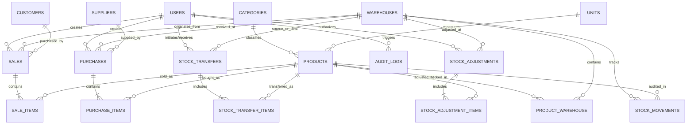

# هندسة وتصميم قاعدة البيانات — MizanFlow
**المشروع:** MizanFlow  
**المحرك المعتمد:** MySQL 8.4 LTS (InnoDB Engine, utf8mb4_unicode_ci)  
**معيار الاتساق:** ACID Compliant Transactions with Strict Foreign Key Constraints  

---

## 1. مخطط الكيانات والعلاقات (Entity-Relationship Diagram)

---

## 2. معايير الدقة العشرية والأرقام (Decimal Precision Standards)

للقضاء التام على أخطاء التقريب التراكمية في العمليات الحسابية المتكررة:
1. **القيم المالية والتكاليف الداخلية:** تُخزن بدقة **`DECIMAL(15, 4)`**.
   * يُطبق على: `weighted_average_cost`، `unit_price`، `unit_cost`، وتكلفة الوحدة التاريخية في بنود الفواتير.
2. **الإجماليات والذمم المالية:** تُخزن بدقة **`DECIMAL(15, 2)`**.
   * يُطبق على: إجمالي الفاتورة، مبالغ الضرائب والخصومات، والمستحقات في حسابات العملاء والموردين.
3. **الكميات والأوزان:** تُخزن بدقة **`DECIMAL(12, 3)`**.
   * يدعم الوحدات الصحيحة (مثل الحبات والكراتين: 1.000) والوحدات الكسرية (مثل الكيلوجرام والأمتار واللترات: 2.750).

---

## 3. تفاصيل الجداول والحقول والقيود (Table Schemas)

### 3.1 جدول المستخدمين والأدوار (`users`)
يدير بيانات المستخدمين وأدوارهم ومستودعاتهم الافتراضية.

| اسم الحقل | النوع | القيود والملاحظات |
| :--- | :--- | :--- |
| `id` | `BIGINT UNSIGNED` | `AUTO_INCREMENT`, Primary Key |
| `name` | `VARCHAR(150)` | Not Null |
| `username` | `VARCHAR(50)` | Not Null, **`UNIQUE`** |
| `email` | `VARCHAR(150)` | Not Null, **`UNIQUE`** |
| `password` | `VARCHAR(255)` | Not Null (Bcrypt hashed) |
| `role` | `ENUM` | `('admin', 'manager', 'cashier')`, Not Null |
| `default_warehouse_id` | `BIGINT UNSIGNED` | Nullable, Foreign Key (`warehouses.id`) |
| `is_active` | `BOOLEAN` | Default `true` |
| `created_at` / `updated_at` | `TIMESTAMP` | Standard timestamps |

---

### 3.2 جدول المستودعات (`warehouses`)
يمثل نقاط التخزين والفروع التابعة للشركة.

| اسم الحقل | النوع | القيود والملاحظات |
| :--- | :--- | :--- |
| `id` | `BIGINT UNSIGNED` | Primary Key |
| `code` | `VARCHAR(20)` | **`UNIQUE`**, Not Null (رمز فريد: مثل `WH-MAIN`, `WH-BRANCH1`) |
| `name` | `VARCHAR(100)` | Not Null |
| `location` | `VARCHAR(255)` | Nullable |
| `manager_name` | `VARCHAR(100)` | Nullable |
| `phone` | `VARCHAR(30)` | Nullable |
| `is_active` | `BOOLEAN` | Default `true` |
| `created_at` / `updated_at` | `TIMESTAMP` | Standard timestamps |

---

### 3.3 جدول التصنيفات (`categories`)
تصنيف شجري للمنتجات.

| اسم الحقل | النوع | القيود والملاحظات |
| :--- | :--- | :--- |
| `id` | `BIGINT UNSIGNED` | Primary Key |
| `parent_id` | `BIGINT UNSIGNED` | Nullable, Foreign Key (`categories.id`, `ON DELETE SET NULL`) |
| `code` | `VARCHAR(30)` | **`UNIQUE`**, Not Null |
| `name` | `VARCHAR(100)` | Not Null |
| `description` | `TEXT` | Nullable |
| `created_at` / `updated_at` | `TIMESTAMP` | Standard timestamps |

---

### 3.4 جدول وحدات القياس (`units`)
وحدات قياس المنتجات (حبة، كرتون، كجم).

| اسم الحقل | النوع | القيود والملاحظات |
| :--- | :--- | :--- |
| `id` | `BIGINT UNSIGNED` | Primary Key |
| `code` | `VARCHAR(20)` | **`UNIQUE`**, Not Null (مثل: `PCS`, `BOX`, `KG`) |
| `name` | `VARCHAR(50)` | Not Null |
| `allow_decimals` | `BOOLEAN` | Default `false` (لتحديد إمكانية إدخال كسور) |
| `created_at` / `updated_at` | `TIMESTAMP` | Standard timestamps |

---

### 3.5 جدول المنتجات (`products`)
كتالوج المنتجات الرئيسي.

| اسم الحقل | النوع | القيود والملاحظات |
| :--- | :--- | :--- |
| `id` | `BIGINT UNSIGNED` | Primary Key |
| `sku` | `VARCHAR(50)` | **`UNIQUE`**, Not Null (رمز الصنف الفريد الصارم) |
| `barcode` | `VARCHAR(50)` | **`UNIQUE`**, Nullable (لقراءة مسدس الباركود) |
| `name` | `VARCHAR(200)` | Not Null |
| `category_id` | `BIGINT UNSIGNED` | Not Null, Foreign Key (`categories.id`) |
| `unit_id` | `BIGINT UNSIGNED` | Not Null, Foreign Key (`units.id`) |
| `min_reorder_level` | `DECIMAL(12, 3)` | Default `0.000` (حد الطلب التنبيهي) |
| `default_sale_price` | `DECIMAL(15, 4)` | Not Null, Default `0.0000` |
| `is_active` | `BOOLEAN` | Default `true` |
| `created_at` / `updated_at` | `TIMESTAMP` | Standard timestamps |

---

### 3.6 جدول رصيد المنتج في المستودع وتكلفته (`product_warehouse`)
الجدول المحوري الذي يربط المنتج بالمستودع ويحتفظ بالرصيد اللحظي ومتوسط التكلفة المرجح (WAC).

| اسم الحقل | النوع | القيود والملاحظات |
| :--- | :--- | :--- |
| `id` | `BIGINT UNSIGNED` | Primary Key |
| `product_id` | `BIGINT UNSIGNED` | Not Null, Foreign Key (`products.id`, `ON DELETE CASCADE`) |
| `warehouse_id` | `BIGINT UNSIGNED` | Not Null, Foreign Key (`warehouses.id`, `ON DELETE RESTRICT`) |
| `quantity` | `DECIMAL(12, 3)` | Not Null, Default `0.000` (**ممنوع القيم السالبة**) |
| `reserved_quantity` | `DECIMAL(12, 3)` | Not Null, Default `0.000` (المحجوز لتحويلات جارية) |
| `weighted_average_cost`| `DECIMAL(15, 4)` | Not Null, Default `0.0000` (**متوسط التكلفة المرجح WAC**) |
| `created_at` / `updated_at` | `TIMESTAMP` | Standard timestamps |

* **الفهارس والقيود:**
  * `UNIQUE KEY unique_product_in_warehouse (product_id, warehouse_id)`
  * `INDEX idx_warehouse_qty (warehouse_id, quantity)`

---

### 3.7 جدول الموردين (`suppliers`)

| اسم الحقل | النوع | القيود والملاحظات |
| :--- | :--- | :--- |
| `id` | `BIGINT UNSIGNED` | Primary Key |
| `name` | `VARCHAR(150)` | Not Null |
| `company_name` | `VARCHAR(150)` | Nullable |
| `tax_number` | `VARCHAR(50)` | Nullable |
| `phone` | `VARCHAR(30)` | Nullable |
| `email` | `VARCHAR(100)` | Nullable |
| `balance` | `DECIMAL(15, 2)` | Default `0.00` (المستحقات الحالية للمورد) |
| `created_at` / `updated_at` | `TIMESTAMP` | Standard timestamps |

---

### 3.8 جدول العملاء (`customers`)

| اسم الحقل | النوع | القيود والملاحظات |
| :--- | :--- | :--- |
| `id` | `BIGINT UNSIGNED` | Primary Key |
| `name` | `VARCHAR(150)` | Not Null |
| `phone` | `VARCHAR(30)` | Nullable |
| `email` | `VARCHAR(100)` | Nullable |
| `tax_number` | `VARCHAR(50)` | Nullable |
| `credit_limit` | `DECIMAL(15, 2)` | Default `0.00` (سقف الائتمان) |
| `balance` | `DECIMAL(15, 2)` | Default `0.00` (مديونية العميل) |
| `created_at` / `updated_at` | `TIMESTAMP` | Standard timestamps |

---

### 3.9 جدول فواتير المشتريات (`purchases`)

| اسم الحقل | النوع | القيود والملاحظات |
| :--- | :--- | :--- |
| `id` | `BIGINT UNSIGNED` | Primary Key |
| `invoice_number` | `VARCHAR(50)` | **`UNIQUE`**, Not Null (توليد تسلسلي: `PO-2026-000001`) |
| `supplier_invoice_ref` | `VARCHAR(50)` | Nullable (رقم فاتورة المورد الأصلية) |
| `supplier_id` | `BIGINT UNSIGNED` | Not Null, Foreign Key (`suppliers.id`) |
| `warehouse_id` | `BIGINT UNSIGNED` | Not Null, Foreign Key (`warehouses.id`) |
| `user_id` | `BIGINT UNSIGNED` | Not Null, Foreign Key (`users.id`) |
| `issue_date` | `DATE` | Not Null |
| `status` | `ENUM` | `('draft', 'approved', 'cancelled')`, Default `'draft'` |
| `subtotal` | `DECIMAL(15, 2)` | Not Null, Default `0.00` |
| `tax_amount` | `DECIMAL(15, 2)` | Not Null, Default `0.00` |
| `discount_amount` | `DECIMAL(15, 2)` | Not Null, Default `0.00` |
| `total_amount` | `DECIMAL(15, 2)` | Not Null, Default `0.00` |
| `paid_amount` | `DECIMAL(15, 2)` | Not Null, Default `0.00` |
| `notes` | `TEXT` | Nullable |
| `created_at` / `updated_at` | `TIMESTAMP` | Standard timestamps |

* **ملاحظة:** لا تؤثر الفاتورة على المخزون أو التكلفة طالما كانت في حالة `draft`. فور تحولها إلى `approved` يتم قفلها وتطبيق الحركات.

---

### 3.10 جدول بنود فواتير المشتريات (`purchase_items`)

| اسم الحقل | النوع | القيود والملاحظات |
| :--- | :--- | :--- |
| `id` | `BIGINT UNSIGNED` | Primary Key |
| `purchase_id` | `BIGINT UNSIGNED` | Not Null, Foreign Key (`purchases.id`, `ON DELETE CASCADE`) |
| `product_id` | `BIGINT UNSIGNED` | Not Null, Foreign Key (`products.id`) |
| `quantity` | `DECIMAL(12, 3)` | Not Null |
| `unit_cost` | `DECIMAL(15, 4)` | Not Null (**التكلفة التاريخية للوحدة عند الشراء**) |
| `tax_percent` | `DECIMAL(5, 2)` | Default `0.00` |
| `discount_amount` | `DECIMAL(15, 2)` | Default `0.00` |
| `total_cost` | `DECIMAL(15, 4)` | Not Null |
| `created_at` / `updated_at` | `TIMESTAMP` | Standard timestamps |

---

### 3.11 جدول فواتير المبيعات (`sales`)

| اسم الحقل | النوع | القيود والملاحظات |
| :--- | :--- | :--- |
| `id` | `BIGINT UNSIGNED` | Primary Key |
| `invoice_number` | `VARCHAR(50)` | **`UNIQUE`**, Not Null (توليد تسلسلي: `INV-2026-000001`) |
| `customer_id` | `BIGINT UNSIGNED` | Nullable, Foreign Key (`customers.id`) (عميل نقدي إن كان فارغاً) |
| `warehouse_id` | `BIGINT UNSIGNED` | Not Null, Foreign Key (`warehouses.id`) |
| `user_id` | `BIGINT UNSIGNED` | Not Null, Foreign Key (`users.id`) (الكاشير) |
| `invoice_date` | `DATETIME` | Not Null |
| `payment_type` | `ENUM` | `('cash', 'card', 'credit', 'split')`, Not Null |
| `status` | `ENUM` | `('completed', 'voided', 'partially_returned')`, Default `'completed'` |
| `subtotal` | `DECIMAL(15, 2)` | Not Null |
| `tax_amount` | `DECIMAL(15, 2)` | Not Null, Default `0.00` |
| `discount_amount` | `DECIMAL(15, 2)` | Not Null, Default `0.00` |
| `total_amount` | `DECIMAL(15, 2)` | Not Null |
| `paid_amount` | `DECIMAL(15, 2)` | Not Null |
| `notes` | `TEXT` | Nullable |
| `created_at` / `updated_at` | `TIMESTAMP` | Standard timestamps |

---

### 3.12 جدول بنود فواتير المبيعات (`sale_items`)

| اسم الحقل | النوع | القيود والملاحظات |
| :--- | :--- | :--- |
| `id` | `BIGINT UNSIGNED` | Primary Key |
| `sale_id` | `BIGINT UNSIGNED` | Not Null, Foreign Key (`sales.id`, `ON DELETE CASCADE`) |
| `product_id` | `BIGINT UNSIGNED` | Not Null, Foreign Key (`products.id`) |
| `quantity` | `DECIMAL(12, 3)` | Not Null |
| `unit_price` | `DECIMAL(15, 4)` | Not Null (سعر البيع التاريخي الفعلي) |
| `unit_cost_snapshot`| `DECIMAL(15, 4)` | Not Null (**لقطة WAC التاريخية لحظة البيع لحساب الربح الإجمالي بدقة**) |
| `tax_percent` | `DECIMAL(5, 2)` | Default `0.00` |
| `discount_amount` | `DECIMAL(15, 2)` | Default `0.00` |
| `total_price` | `DECIMAL(15, 4)` | Not Null |
| `created_at` / `updated_at` | `TIMESTAMP` | Standard timestamps |

---

### 3.13 جدول تحويلات المخزون بين المستودعات (`stock_transfers`)

| اسم الحقل | النوع | القيود والملاحظات |
| :--- | :--- | :--- |
| `id` | `BIGINT UNSIGNED` | Primary Key |
| `transfer_number` | `VARCHAR(50)` | **`UNIQUE`**, Not Null (`TR-2026-000001`) |
| `from_warehouse_id` | `BIGINT UNSIGNED` | Not Null, Foreign Key (`warehouses.id`) |
| `to_warehouse_id` | `BIGINT UNSIGNED` | Not Null, Foreign Key (`warehouses.id`) |
| `created_by_user_id`| `BIGINT UNSIGNED` | Not Null, Foreign Key (`users.id`) |
| `received_by_user_id`| `BIGINT UNSIGNED`| Nullable, Foreign Key (`users.id`) |
| `status` | `ENUM` | `('draft', 'in_transit', 'completed', 'cancelled')`, Default `'draft'` |
| `dispatched_at` | `DATETIME` | Nullable |
| `received_at` | `DATETIME` | Nullable |
| `notes` | `TEXT` | Nullable |
| `created_at` / `updated_at` | `TIMESTAMP` | Standard timestamps |

---

### 3.14 جدول بنود التحويل بين المستودعات (`stock_transfer_items`)

| اسم الحقل | النوع | القيود والملاحظات |
| :--- | :--- | :--- |
| `id` | `BIGINT UNSIGNED` | Primary Key |
| `stock_transfer_id` | `BIGINT UNSIGNED` | Not Null, Foreign Key (`stock_transfers.id`, `ON DELETE CASCADE`) |
| `product_id` | `BIGINT UNSIGNED` | Not Null, Foreign Key (`products.id`) |
| `quantity_sent` | `DECIMAL(12, 3)` | Not Null |
| `quantity_received` | `DECIMAL(12, 3)` | Nullable |
| `unit_cost_snapshot`| `DECIMAL(15, 4)` | Not Null (**تكلفة WAC للمستودع المصدر وقت التحويل**) |
| `created_at` / `updated_at` | `TIMESTAMP` | Standard timestamps |

---

### 3.15 جدول التسويات الجردية (`stock_adjustments`)

| اسم الحقل | النوع | القيود والملاحظات |
| :--- | :--- | :--- |
| `id` | `BIGINT UNSIGNED` | Primary Key |
| `adjustment_number` | `VARCHAR(50)` | **`UNIQUE`**, Not Null (`ADJ-2026-000001`) |
| `warehouse_id` | `BIGINT UNSIGNED` | Not Null, Foreign Key (`warehouses.id`) |
| `user_id` | `BIGINT UNSIGNED` | Not Null, Foreign Key (`users.id`) |
| `adjustment_date` | `DATE` | Not Null |
| `reason` | `VARCHAR(255)` | Not Null (تلف، عجز جرد، فائض، منتهي الصلاحية) |
| `status` | `ENUM` | `('draft', 'approved', 'cancelled')`, Default `'draft'` |
| `notes` | `TEXT` | Nullable |
| `created_at` / `updated_at` | `TIMESTAMP` | Standard timestamps |

---

### 3.16 جدول بنود التسويات الجردية (`stock_adjustment_items`)

| اسم الحقل | النوع | القيود والملاحظات |
| :--- | :--- | :--- |
| `id` | `BIGINT UNSIGNED` | Primary Key |
| `stock_adjustment_id`| `BIGINT UNSIGNED`| Not Null, Foreign Key (`stock_adjustments.id`, `ON DELETE CASCADE`) |
| `product_id` | `BIGINT UNSIGNED` | Not Null, Foreign Key (`products.id`) |
| `type` | `ENUM` | `('in', 'out')`, Not Null (إضافة رصيد فائض، أو تخفيض رصيد عجز/تلف) |
| `quantity` | `DECIMAL(12, 3)` | Not Null (كمية موجبة) |
| `unit_cost` | `DECIMAL(15, 4)` | Not Null (تعتمد على WAC في حالة الإخراج، أو تكلفة محددة في حالة الإدخال) |
| `created_at` / `updated_at` | `TIMESTAMP` | Standard timestamps |

---

### 3.17 جدول سجل حركات المخزون غير القابل للتعديل (`stock_movements`)
**دفتر الأستاذ المخزني العام (The Inventory Ledger)**: لا يتم الحذف أو التعديل في هذا الجدول إطلاقاً.

| اسم الحقل | النوع | القيود والملاحظات |
| :--- | :--- | :--- |
| `id` | `BIGINT UNSIGNED` | Primary Key, `AUTO_INCREMENT` |
| `product_id` | `BIGINT UNSIGNED` | Not Null, Foreign Key (`products.id`) |
| `warehouse_id` | `BIGINT UNSIGNED` | Not Null, Foreign Key (`warehouses.id`) |
| `movement_type` | `ENUM` | `('purchase', 'purchase_return', 'sale', 'sale_return', 'transfer_out', 'transfer_in', 'adjustment_in', 'adjustment_out')` |
| `reference_type` | `VARCHAR(50)` | Not Null (اسم الفئة المرتبطة: `App\Models\Sale`, `Purchase`, etc.) |
| `reference_id` | `BIGINT UNSIGNED` | Not Null (المعرف المصدري) |
| `quantity` | `DECIMAL(12, 3)` | Not Null (القيمة الرياضية للحركة: موجبة للدخول، سالبة للخروج) |
| `before_quantity` | `DECIMAL(12, 3)` | Not Null (الرصيد في المستودع قبل الحركة) |
| `after_quantity` | `DECIMAL(12, 3)` | Not Null (الرصيد في المستودع بعد الحركة) |
| `unit_cost` | `DECIMAL(15, 4)` | Not Null (تكلفة الوحدة للحركة) |
| `total_cost` | `DECIMAL(15, 4)` | Not Null (`quantity * unit_cost`) |
| `user_id` | `BIGINT UNSIGNED` | Not Null, Foreign Key (`users.id`) |
| `created_at` | `TIMESTAMP` | Not Null (توقيت وقوع الحركة الدقيق) |

* **الفهارس الاستعلامية الحرجة (Crucial Indexes):**
  * `INDEX idx_prod_wh_time (product_id, warehouse_id, created_at)`: لتوليد كشف حركة الصنف الزمني بسرعة فائقة.
  * `INDEX idx_ref_lookup (reference_type, reference_id)`: للتتبع العكسي من الفاتورة إلى حركاتها.

---

### 3.18 جدول سجل التدقيق والأمان (`audit_logs`)

| اسم الحقل | النوع | القيود والملاحظات |
| :--- | :--- | :--- |
| `id` | `BIGINT UNSIGNED` | Primary Key |
| `user_id` | `BIGINT UNSIGNED` | Nullable, Foreign Key (`users.id`, `ON DELETE SET NULL`) |
| `event` | `VARCHAR(50)` | Not Null (`created`, `updated`, `approved`, `voided`, `login`) |
| `auditable_type` | `VARCHAR(100)` | Not Null |
| `auditable_id` | `BIGINT UNSIGNED` | Not Null |
| `old_values` | `JSON` | Nullable (القيم السابقة) |
| `new_values` | `JSON` | Nullable (القيم الجديدة) |
| `ip_address` | `VARCHAR(45)` | Nullable |
| `user_agent` | `TEXT` | Nullable |
| `created_at` | `TIMESTAMP` | Not Null |
